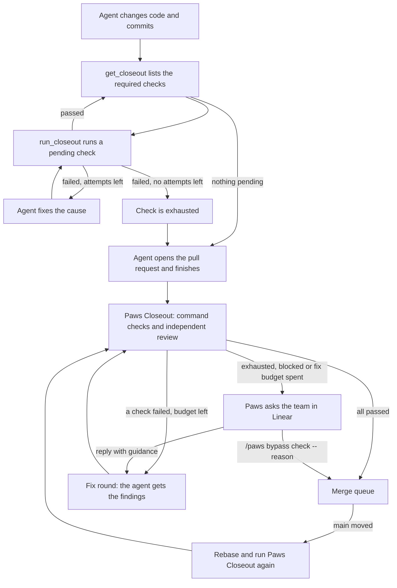

# How Closeout runs

Closeout checks a candidate before Paws opens or merges its pull request. The checks and their retry limits come from the repository's `.agents/closeout.yaml`, or from a [local Closeout policy](local-closeout.md).

Each candidate goes through Closeout twice:

1. **Agent Closeout.** The agent runs the command checks itself while it works.
2. **Paws Closeout.** After the agent's turn ends, Paws verifies the result, runs the independent review, and decides whether the candidate can be published.

## Agent Closeout

The agent uses two tools in its session:

- `get_closeout` returns the required checks for the changed paths, their status, and the ids still pending. It runs nothing.
- `run_closeout` runs one pending check, after any setup steps it needs, and records the result for the current commit.

Command checks run in the agent's workspace. On a remote runner they run on that runner. Review checks are listed but not run here, because the review must come from a different session.

Each check has its own retry limit, `retry.maxFailedAttemptsPerItem`, which is 3 in this repository. With `scope: task`, failed attempts count across the whole task, including new commits. When a check fails, the agent fixes the cause and runs it again. When a check reaches its limit, it is exhausted. The agent stops retrying it and finishes with a short note on why. Paws Closeout then decides what happens next.

If the agent thinks an exhausted check can be skipped for this change, it calls `request_closeout_skip` with the check ids and its reason before it finishes. The tool accepts only checks that are exhausted, so their last attempt failed. Reviews are not accepted. Calling it again replaces the request. The request is not a bypass. It goes into the question Paws asks the team.

The agent cannot end its turn while a check is still pending. When the agent tries to finish, the Stop hook checks the Closeout status and sends the agent back with the pending check ids. A check that is exhausted does not hold the agent back.

## Paws Closeout

When the turn ends, the item moves to `verifying` and Paws runs the policy against the candidate commit:

- **Command checks.** On a local runner, Paws runs them against the candidate checkout. On a remote runner, Paws uses the agent Closeout result for the same commit. A check passes when that result has nothing pending and nothing blocked.
- **Independent review.** A reviewer in a separate session runs the review skill. A finding at or above the policy's `failOn` severity fails the review.

The run page shows these steps and their output while they run.

### Fix rounds

When a check fails, Paws sends the findings and the failing output back to the implementing agent as a fix round. The agent fixes the cause and commits, and Paws runs Closeout again on the new commit.

A fix round that ends without a usable commit still uses one attempt. The next round gets the same findings plus the reason the last round failed. A cancelled fix stops at once.

The number of fix rounds is limited. Paws allows `maxFailedAttemptsPerItem × (checks + setup steps) − 1` rounds. Each check still stops at its own limit, so a check that keeps failing is exhausted before the overall budget runs out.

### When Paws asks the team

Paws asks in the issue's Linear session when Closeout cannot pass on its own:

- a check is exhausted,
- the fix budget is spent,
- the policy blocks the candidate, or a fix round cannot continue.

The question lists every check with its status and attempts. There are two ways to answer:

- **Reply with guidance.** The agent gets a new fix round with your guidance, and the checks get a fresh round of attempts with the same limits. Earlier evidence is kept.
- **Bypass.** `/paws bypass check-id -- reason`, or `/paws bypass check-a,check-b -- reason` for several checks, accepts those checks for this exact candidate. The bypass is recorded with the task, base, head, policy and your reason. It does not carry over to another commit.

When the agent asked to skip checks, the question also shows the checks the team can still bypass, the agent's reason, and links to the videos and screenshots the agent published for them. Each question carries one request. Until someone answers, the run page shows "Skip requested in Linear" with the reason and an "Open in Linear" link. Paws has no skip button.

Only a bypass in reply to this question counts. A bypass the agent proposes in its own question has no effect.

### After acceptance

An accepted candidate enters the merge queue. If `main` moves before the merge, Paws rebases the branch and runs Paws Closeout again on the rebased commit. Closeout must accept the commit that is actually merged.
