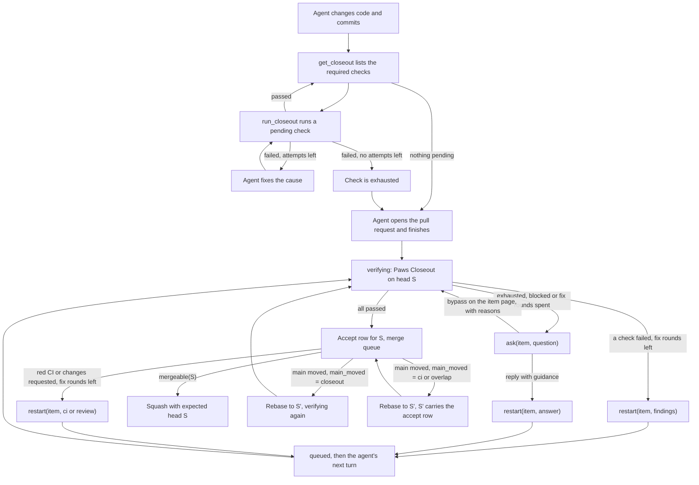

# How Closeout runs

Closeout checks a candidate before Paws opens or merges its pull request. The checks and their retry limits come from the repository's `.agents/closeout.yaml`, or from a [local Closeout policy](local-closeout.md).

Each candidate goes through Closeout twice:

1. **Agent Closeout.** The agent runs the command checks itself while it works.
2. **Paws Closeout.** After the agent's turn ends, Paws verifies the result, runs the independent review, and decides whether the candidate can be published.

Before the pull request, the policy in this repository also runs two hygiene checks. `bun run links` fails on a broken local link, a doc under `docs/` that no other document links to, or an inline `src/...` path that no longer exists. `bun run knip` fails on an unused file, an unused or unlisted dependency, or a duplicate export. Delete an outdated page instead of keeping it; an orphaned page is a failed check.



## Agent Closeout

The agent uses two tools in its session:

- `get_closeout` returns the required checks for the changed paths, their status, and the ids still pending. It runs nothing.
- `run_closeout` runs one pending check, after any setup steps it needs, and records the result for the current commit.

Command checks run in the agent's workspace. On a remote runner they run on that runner. Review checks are listed but not run here, because the review must come from a different session. Evidence checks run nothing: `run_closeout` answers with the hint and the `publish_artifact` call to make.

Each check has its own retry limit, `retry.attempts_per_check`, which is 3 in this repository. With `scope: task`, failed attempts count across the whole task, including new commits. When a check fails, the agent fixes the cause and runs it again. When a check reaches its limit, it is exhausted. The agent stops retrying it and finishes with a short note on why. Paws Closeout then decides what happens next.

The agent cannot end its turn while a check is still pending. When the agent tries to finish, the Stop hook checks the Closeout status and sends the agent back with the pending check ids. A check that is exhausted does not hold the agent back.

## Evidence checks

An `evidence` check asks the agent for screenshots or videos instead of running a command. This repository requires one when a change touches the status dashboard or the landing page:

```yaml
- id: visual-proof
  kind: evidence
  gate: beforePR
  paths: ["src/web/**", "landing/**"]
  media: [image, video]
  minimum: 1
  hint: Screenshot each changed screen at desktop width and at 390 px.
```

- `paths` works as it does for the other kinds. Without a matching changed file, the check is not required.
- `media` lists which files count: `image`, `video`, or both. The default is both.
- `minimum` is how many files the check needs, from 1 to 100. The default is 1.
- `hint` is shown to the agent by `get_closeout` and in the fix round.

The agent publishes each file with `publish_artifact` and `checkId: "visual-proof"`. Paws keeps it in the evidence store, uploads it to Linear through the outbox, and embeds it in the task's session with the Paws link on the line below. Images up to 10 MB and videos up to 50 MB show inline; larger files post only the Paws link, with a note. A failed upload retries, and the last attempt posts the link instead. A file counts when it was published by this task at the candidate commit or at an earlier commit that the candidate contains, so a screenshot taken before the last commit still counts. Until enough files exist, `get_closeout` lists the check as pending and the agent cannot finish.

After the session's pull request response, evidence is attached to the issue, not posted. A thought would reopen the completed session (see [The post-PR rule](linear-agent-sessions.md#the-post-pr-rule)), so a file published by a fix round or for the re-verification of a rebased head is uploaded with `uploadOnly` and becomes a Linear attachment on the issue (`linear.attachment`), titled with its display name and bound to its head commit. The session stays quiet, and the run page and the issue show the files.

Paws Closeout counts the same files. With too few, the check fails, and a fix round asks the agent to publish the proof. That fix round does not need a new commit. Evidence checks use the same fix budget as other checks, and bypassing `visual-proof` with a reason on the item page accepts one without proof. The run page shows the published files in its evidence gallery.

### Human visual review

`approval: human` on an evidence check also requires a person to accept the files:

```yaml
- id: visual-proof
  kind: evidence
  gate: beforePR
  paths: ["src/web/**", "landing/**"]
  approval: human
```

The setting is optional. Without it, published files are enough, as above.

With it, `get_closeout` adds "Publish the screenshots, then a person reviews them in Paws." to the hint. Once enough files are published, it lists the check as `pending` and leaves it out of the pending ids, so the agent can finish its turn.

The review is a pending-human check inside the Closeout evaluation of the candidate commit. When the turn ends, the item moves to `verifying`, and Paws asks with a link: one Linear elicitation without options that names the changed screens and links to the Visual review card on the item page, where the screenshots are in view. The command checks and the independent review run on the same commit meanwhile. The delegator or the project lead decides on the card; Paws reminds once after 24 hours, and the item is listed under Needs you. When the other checks pass first, the item waits in `awaiting_input` and gives its runner back.

- **Approve <commit>** passes the check for that commit and those files. If the other checks are still running, the evaluation finishes when they do. If they are done, Paws completes the evaluation from their recorded results, without running them again, and the commit is accepted.
- **Request changes** restarts the item with the note and any marks drawn on the screenshots (restart reason `review`). The agent's next turn ends in a new evaluation of its new commit. After three rounds of changes Paws asks whether to keep going.
- **Stop** stops the item and keeps its branch.
- A reply in Linear is a change request with its text. It never approves the screens, whatever it says.
- A Paws without an https dashboard link (`PAWS_PUBLIC_URL`) cannot show the screens, so it does not ask: the check stays unapproved and Paws says why once.
- If another check fails, the pending review is cancelled: a fix round replaces the commit.

The review and its approval belong to the candidate commit they were asked at, and to the files the reviewer saw. When the commit changes, Paws compares the task's patch against main. A rebase that leaves the patch the same keeps an open review open and carries an accepted one to the new commit, so the reviewer is not asked again for the same diff. A different patch cancels an open review and asks again with the latest files. If files were published after an accepted review, Paws asks a new round with all of them.

A file published again for the same check, with the same display name, at the same commit replaces the earlier copy. Paws counts, asks about and lists in the pull request only the latest copy, so a review never needs to cover a superseded one. The run page shows the latest copy of each file and folds the earlier ones, from this or an older commit, under Earlier versions. The stored files stay.

Paws Closeout judges the check from an approval record: the task, the check id, the ids of the files the reviewer saw, who approved, and when. The check passes when an approval for this task and check names every file the check counts at the candidate commit. A file published after the review, for example after the reviewer asked for changes, is not covered, so the old approval no longer counts. Without a matching approval the check is `missing`: the decision is blocked, not rejected, so no fix round starts. Too few files still fail as above.

## Paws Closeout

When the turn ends, the item moves to `verifying` and Paws runs the policy against the candidate commit:

- **Command checks.** On a local runner, Paws runs them against the candidate checkout. On a remote runner, Paws uses the agent Closeout result for the same commit. A check passes when that result has nothing pending and nothing blocked. When a commit has no result, for example after a rebase, Paws runs the checks on the item's runner against that commit, the same way `run_closeout` does, and judges those results. A missing result never counts as a failed check. If the runner cannot run them, Paws retries, and then asks in Linear, saying that the checks could not run.
- **Independent review.** The reviewer profile's agent runs its own review command on the item's runner, in the run's checkout at the candidate commit, with the runner's login: Codex runs `codex exec review --base <base>`, and Claude runs `claude -p --permission-mode plan "/code-review <base>..<head>"`. The command's read-only review is the sandbox. Paws sends no prompt with it: the review skill, the diff and the task brief stay out, and the policy digest still records the skill. Codex follows its own rubric and `AGENTS.md`; Claude follows `CLAUDE.md`. The final message is the findings array, with one re-ask in the same review when it does not parse. A finding at or above the policy's `failOn` severity fails the review. The runner must be 0.1.47 or later. Three optional settings on the review item make it faster:
  - `scope: diff` is accepted, but the review command has no slot for it, so the review reads what the command reads.
  - `parallel: true` starts the review alongside the command checks instead of after them.
  - `minChangedLines: N` skips the review when the change adds and removes fewer than N lines.
- **Security review.** In this repository, a candidate that changes a high-risk path also gets `security-review`: a second reviewer, in its own session and on a different model, runs `.agents/skills/security-paws/SKILL.md` on the diff. It checks the rules Paws sets for itself: secrets stay in `~/.paws/secrets` and out of logs and the agent environment, webhooks fail closed, routes and answers check authorization, SQL is not built from input, paths stay inside the worktree, and child processes are not started from input. A P1 or P0 finding fails it. Its `paths` list the high-risk globs, among them `src/auth/**`, `src/credentials/**`, the webhook handlers, route modules, and `.agents/**`. They are the same list as the repository's `.paws/high-risk-paths`, which makes a candidate's risk tier high, and `test/closeout-security-review.test.ts` fails when the two differ. A candidate that touches none of them, such as a docs-only change, skips it. The Risk card on the issue page shows the tier, the paths that matched with the list each came from (Settings › Merging › High-risk paths or `.paws/high-risk-paths`), and whether the security review ran or was skipped.

The run page shows these steps and their output while they run. A review row shows how long the reviewer took and how many tokens it reported.

The reviewer's model and effort are set in Settings, under Agents.

### Fix rounds

A fix round is one `restart(item, reason)`: the one operation that sends an item back to the agent. Restart cancels the item's pending jobs, releases its runner slot and merge lane, records the handoff and its reason, and moves the item to `queued`. It keeps the run and the Linear session, so the round reads as part of the same story. The agent's next turn starts from the handoff and ends in `verifying` on its new commit.

Three causes are fix rounds:

| Reason     | Cause                                                          | Handoff                                                                            |
| ---------- | -------------------------------------------------------------- | ---------------------------------------------------------------------------------- |
| `findings` | Paws Closeout rejects the candidate                            | The findings and the failing output                                                |
| `ci`       | CI fails on the pull request head                              | The failing CI checks                                                              |
| `review`   | A changes-requested review or new comments on the pull request | The review or comments and their unresolved threads, once per review or comment id |

They share one counter, `retry.fix_rounds_per_item`, which defaults to 3 and only counts rounds since the latest reply from a person in the item's session. Adding checks does not raise it. Each check still stops at its own limit, `retry.attempts_per_check`, so a check that keeps failing is exhausted before the fix rounds run out. The session title, the progress line and the agent prompt name whichever limit comes first, from the failed attempts each failed check has recorded so far. The first Closeout run spends one attempt, so with the defaults a check that fails from the start reads "fixing Closeout findings (1 of 2)". When a different check starts failing in a later round, the limit is worked out again from that check's attempts.

A fix round that ends without a usable commit still counts. The next round gets the same findings plus the reason the last one failed. A cancelled fix stops at once.

For a review, the handoff tells the agent to fix what it is confident about and to ask the team in the session before changing anything unclear. A new comment restarts the item the same way: a comment-only review, a single inline comment or a conversation comment, from a person or another bot such as Cursor Bugbot. Comments that arrive while a turn or evaluation runs wait for it, and comments less than a minute apart (up to five minutes in all) become one restart. The merge waits for them. Paws ignores edits and deletions, its own App's comments, forks, ended items, and bots that only post status: the default list in `DEFAULT_IGNORED_COMMENT_BOTS` (Cloudflare Pages, Linear, Codecov, Netlify, Vercel, changesets), or `ignore_comment_bots` under `[merge.repositories."owner/repo"]` in its place. With the fix rounds spent, the next comment asks the team instead.

Two other reasons send an item back without spending a fix round: `conflict`, a rebase return from the merge lane (see [After acceptance](#after-acceptance)), and `follow_up` or `answer`, a person's message in the session. Setup faults retry once and then ask, without spending a fix round. Infrastructure faults spend nothing.

### When Paws asks the team

Paws asks through `ask(item, question)`, the one operation that asks a person. It opens one Linear elicitation in the item's session and moves the item to `awaiting_input`. It is also the only activity that reopens a session after its pull request response, because a person must see it. Paws asks when:

- a check is exhausted (`attempts_per_check` spent),
- the fix rounds are spent, whether by findings, red CI or a changes-requested review,
- the rebase returns are spent (see [After acceptance](#after-acceptance)),
- the policy blocks the candidate or cannot be read, or
- a setup fault fails again after one retry.

A spent budget is always a question, never a state of its own. `failed` means execution stopped with nothing to ask: a crash budget, a run failure or a start timeout.

The question lists every check with its status and attempts. When the candidate has failed checks and Paws has a public HTTPS link (`PAWS_PUBLIC_URL`), the question is a link ask: Linear gets one Markdown message with the link and no options, and the "Closeout needs your help" card on the item page (`/status/issues/<id>#closeout`) decides. Only the person who delegated the issue or the Linear project's lead can decide there; anyone else is refused and recorded in Audit history.

- **Bypass.** Select failed checks on the card and write a reason for each. The reasons are saved with your name, bound to the task, base, head and policy digest, and Paws verifies the same head again with them. A new commit runs every check again. The pull request body lists each bypassed check with its reason and who approved it, and Audit history records the decision.
- **Send guidance instead.** Paws calls `restart(item, answer)` with your text. The fix rounds and the check attempts start fresh with the same limits, and earlier evidence is kept. Only a person's answer for the item refills a budget; a redispatch or a newer main does not.
- **Stop.** Stops the item and keeps its branch, as the item's Stop control does.

A reply in Linear is guidance, whatever it says. `/paws bypass check -- reason` in a reply bypasses nothing: Paws sends it to the agent as guidance and answers once with the link to the card. Without a public link the question stays a Linear question, a reply is guidance, and no check can be bypassed.

### Rules set to approve

A rule under `rules:` in the policy may set `onFail: approve`, for a rule you sometimes mean to break, like an API contract change. `onFail: fix`, the default, treats a failed rule like any failed check. A failed `approve` rule does not go back to the agent and uses no fix round or fix attempt; it still holds the pull request until a person decides. When other checks failed too, the fix round hands the agent only those, and the rule is checked again on the next head.

When only `approve` rules failed, Paws asks with `ask()`. With a public link, Linear gets one Markdown message with each broken rule's summary and finding and the link to the "Rule break" card on the item page (`/status/issues/<id>#rule`). The probe output stays out of Linear; the card shows it. The delegator or the project lead decides there, with a reason:

- **Approve** accepts the rules' findings for this task, base, head and policy digest. The reason is saved with the approver's name, Audit history records the decision, the pull request body lists it under Bypassed checks, and Paws verifies the same head again. The next head checks the rule again.
- **Send back** calls `restart(item, answer)` with the reason and the finding, as if the rule were `onFail: fix`.

A reply in Linear sends the finding back to the agent with the reply and never approves the break; Paws answers once with the link to the card. Without a public link the question is a Linear question, and a reply sends it back.

### After acceptance

When Closeout accepts head S, it writes an accept row: S, the policy digest it ran under, and any bypass rows for S. The item enters `merge_queue`. The merge lane takes the repository lock, reads the pull request and checks one predicate, `mergeable(S)`:

1. The pull request head is still S.
2. S contains the current `main`. Under `[merge] main_moved = "overlap"`, a head whose files main's new commits do not touch also counts.
3. An accept row exists for S under the current policy digest. Under `main_moved = "ci"` or `"overlap"`, a head the lane rebased from the accepted head carries that head's row.
4. CI is green for S.
5. No review thread is unresolved.
6. Branch protection is satisfied.

Only when all six hold does the lane squash, with GitHub's expected-head guard set to S. A head that changes, or a main that moves between the read and the squash, releases the lane, and the next turn reads again. Paws never merges a head that is neither accepted by Closeout nor rebased by the lane from an accepted head.

When `mergeable(S)` is false, the first failing condition decides:

- **S is behind main.** The lane rebases to a new head S' and releases the lock. What happens next follows `[merge] main_moved` (see the [configuration reference](configuration.md#merge)):
  - `ci` (default): S' carries the accept row of the head it was rebased from and merges once its CI is green. Closeout does not run again.
  - `overlap`: as `ci`, but the lane rebases only when main's new commits touch a file or package root the pull request changes, or GitHub requires branches to be up to date. Otherwise S merges without a rebase.
  - `closeout`: the item goes back to `verifying`. Closeout runs on S' like any candidate. On a remote runner, Paws runs the command checks for S' on the item's runner. A human visual approval carries over when the patch is unchanged. After the pull request, only the title ("rebased onto main, re-verifying") and the plan move.

  Under `ci` and `overlap`, a carried head goes back to `verifying` as well when the policy digest changed or Closeout never accepted the head the lane rebased.

- **No accept row for S, or the policy changed.** S goes back to `verifying`.
- **CI failed.** `restart(item, ci)` while fix rounds are left, then a question.
- **CI pending, threads open or protection unsatisfied.** The item waits in `merge_queue`.

A rebase that conflicts is a rebase return: `restart(item, conflict)` with the conflicting files, after the lane is released. Returns are limited to three in a row on a known main commit and six in any rolling hour. A conflict on an unknown main counts only toward the hour. A newer main does not refill the budget; only a person's reply does. When either limit is reached, Paws asks with the main commits and files involved.

The lane judges only the front of the queue, but a conflict behind it does not wait for its turn. Whenever main moves (the lane merges, or a `push` to the default branch or a merged `pull_request` webhook arrives), Paws reads GitHub's `mergeable` for every other pull request in that repository's `merge_queue`, retrying briefly while GitHub computes it. One that conflicts goes back at once as the same rebase return, under the same budget, and keeps its place in the queue for when Closeout accepts its rebased head. Each head goes back once. A pull request that is only behind main is left for the lane to update when it reaches the front.

The entry policy sets the two budget integers, both defaulting to 3:

```yaml
retry:
  attempts_per_check: 3
  fix_rounds_per_item: 3
```

`maxFailedAttemptsPerItem` remains a legacy alias for `attempts_per_check`. The legacy `[merge] ci_fix_attempts` setting in `config.toml` no longer sets a separate CI budget; CI fixes count against `fix_rounds_per_item`. `[merge] main_moved` decides whether a rebased head runs Closeout again; see the [configuration reference](configuration.md#merge).

### Re-checks take green CI

A command check can name the GitHub checks that run the same command in CI with `ci:`, one pattern where `*` matches any text:

```yaml
- id: test
  kind: command
  gate: beforePR
  exec: ["bun", "run", "test"]
  timeoutSeconds: 1800
  ci: "test (*)"
```

A re-check of an item already in the merge queue (after a CI fix, a conflict fix, or a re-verify) reads CI on the pull request head before it runs Closeout. A first Closeout run, before Closeout ever accepted a head, is unchanged.

- **CI green.** Each mapped check whose pattern matches at least one check, all `SUCCESS`, is recorded as passed from CI: the record keeps the run URL and each check's conclusion, and its line reads "from CI run <link>: `test (0/4)` success, …". The other checks, the rules, the reviews and the evidence checks run on the new head as usual. On a remote runner, the checks run tells the agent to skip the mapped ids.
- **CI pending.** The re-check waits for it, reading again every 15 seconds for up to 45 minutes, rather than running the suite itself. After that it runs the checks.
- **CI red.** No check runs: the item goes to a CI fix round, `restart(item, ci)` with the failing checks, while fix rounds are left. With none left, the checks run and Paws asks as usual.
- **CI unreadable,** or the head is not the pull request's: the checks run as before.

`ci:` is a Paws extension to the policy schema, so a runner older than the change rejects a policy that uses it: ship the deploy and the runner release before the policy.

### Affected tests

In this repository, the `test` check runs `bun scripts/affected-tests.ts`, which runs only the tests the change affects between the run's base and the candidate head. The base is `git merge-base origin/main HEAD`; on a runner, Closeout's checkout points `origin/main` at the run's base. GitHub CI runs the full suite on every pull request and is required before merge, so a test the selection misses still runs before merge.

- **Test files** changed in the diff run.
- **Source files:** a change under `src/<module>/` runs that module's tests, the tests of every module that imports it (followed transitively through other modules), and every other test file that reaches the module, directly, through another module, or through a helper under `test/`. A file directly under `src/`, such as `src/index.ts`, runs the tests that import it.
- **Shared files:** a change to `package.json`, `bun.lock`, `bunfig.toml`, a `tsconfig*.json`, a helper or fixture under `test/`, or anything under `scripts/` runs the full suite.
- **Other files**, such as docs, run the tests whose source names the changed path.
- `test/boundaries.test.ts` and `test/empty-catches.test.ts` always run. Both read every file under `src/` by path.

When the diff, a test, or an imported helper cannot be read, when import parsing fails, or when there is no base, the full suite runs. Imports are parsed as code so fixture strings and comments do not affect the import graph. The check's log starts with the files that ran and why, for example:

````
test/merge-lane.test.ts  imports src/merge/index.ts
full suite (556 files): package.json changed
``` `bun scripts/affected-tests.ts --list <base> <head>` prints the selection without running it.

## Review escapes

A review escape is a bug that Closeout's independent review accepted and a later pull request had to fix. `evals/review-escapes.jsonl` collects the confirmed ones, so a change to the reviewer can be scored against real misses instead of guessed.

### File format

One JSON object per line:

```json
{
  "id": "522-539",
  "original": {
    "pr": 522,
    "title": "Send CPU, memory, disk, OS and version with the runner heartbeat (PAS-332)",
    "base": "ef2d3bfa2ca0cf9a9994eef0b718a906636f44f9",
    "head": "31a28934498edb884f5466d4c7993a4100df28b7",
    "mergeCommit": "7c5ccb79…"
  },
  "fix": { "pr": 539, "title": "fix(runners): remove the runner account type", "mergeCommit": "…" },
  "file": "src/runner-health/heartbeat.ts",
  "line": 42,
  "bug": "The heartbeat dropped the disk size when the runner reported it in bytes.",
  "confirmedBy": "pmdroid",
  "confirmedAt": "2026-10-26",
  "confidence": "confirmed"
}
````

| Field                  | Meaning                                                                                                                           |
| ---------------------- | --------------------------------------------------------------------------------------------------------------------------------- |
| `id`                   | `<original pr>-<fix pr>`. One case per pair.                                                                                      |
| `original`             | The Paws pull request that let the bug through.                                                                                   |
| `original.base`/`head` | The commits Closeout reviewed, from the `Base:` and `Head:` lines Paws writes into its squash message. Replay the review on them. |
| `original.mergeCommit` | Its squash commit on `main`.                                                                                                      |
| `fix`                  | The later pull request that fixed or reverted the lines.                                                                          |
| `file`, `line`         | Where the bug is, as of `original.mergeCommit`.                                                                                   |
| `bug`                  | One sentence on the defect, as a reviewer of the original diff should have stated it.                                             |
| `confirmedBy`, `At`    | The person who confirmed the case, and the date.                                                                                  |
| `confidence`           | `confirmed`, or `likely` when the person confirming is less sure. The reviewer score reports `likely` cases separately.           |
| `note`                 | Optional. Anything a replay or a score should know, such as why the script cannot find the case.                                  |

The head of a squashed pull request is not on `main`. Fetch it with `git fetch origin pull/<pr>/head` before a replay.

### Finding candidates

```sh
bun scripts/review-escapes.ts            # pull requests from gh, last 30 days
bun scripts/review-escapes.ts --source git --branch origin/main   # without gh
bun scripts/review-escapes.ts --days 60 --kinds fix,revert --jsonl
```

The script lists the pull requests merged in the window and keeps those authored by the Paws GitHub App (`--app`, default `paws-helper`) as originals. For every later pull request, it runs `git blame` on the parent of its merge commit over each line it removes or changes. A blamed line from a Paws squash makes a candidate: the original, the fix, the file and line, and a draft bug sentence from the fix's title. Lockfiles, snapshots, blank lines and brace-only lines are skipped, and pairs already in the file are left out.

Each candidate is `revert`, `fix` (a title with words such as fix, bug, race, flaky or broken) or `change`. Most `change` candidates are refactors or new requirements; read them when a fix title doesn't say it is one. Blame needs the full history of `main` in the clone. `--source git` reads squash subjects (`Title (#12)`) and merge commits, so it misses pull requests merged another way. A fix that only adds lines, such as a missing check or a test fixture's missing tie-break, leaves blame nothing to point at, so add those cases by hand (`1006-1015` is one).

### Adding a case

After an incident, or when a candidate holds up:

1. Find the pull request that introduced the bug, and the one that fixed it. Run the script with `--jsonl` and copy the line for that pair, or write it by hand from the fields above.
2. Check that the bug was in the original diff as merged, and that a reviewer reading that diff could have seen it. A requirement that changed later, a refactor, or a bug in code the original only moved is not an escape.
3. Point `file` and `line` at the defect, rewrite `bug` as one sentence about the defect rather than the fix, and set `confirmedBy`, `confirmedAt` and `confidence`.
4. Append the line to `evals/review-escapes.jsonl`. `scripts/review-escapes.test.ts` checks every line's shape.
5. Rescore the reviewer (see [Reviewer score](#reviewer-score)) and commit the report with the case, so the next change is measured against a baseline that includes it.

## Reviewer score

`scripts/review-score.ts` replays a review item from `.agents/closeout.yaml` on known cases and writes a report to `reports/`:

- **Recall.** Each case in `evals/review-escapes.jsonl` counts as caught when the review has a finding at or above `failOn`, on a line the change touched, within five lines (`--tolerance`) of the case's `file` and `line`. A blocking finding somewhere else is listed as "rejected elsewhere", not as caught. `likely` cases are scored apart from `confirmed` ones. The most severe finding near the bug at any severity is recorded too, so the effect of a lower `failOn` can be read off a report.
- **False positives.** Each pull request in `evals/review-clean.jsonl` counts as a false positive when the review would have rejected it. The report gives the rate for Paws squashes and for pull requests merged by hand apart, and both together.
- **Time and cost per review.** Wall time and the tokens Codex reports, including the re-ask. Cost needs a price: `--price input,cached,output` in USD per million tokens. Without one the report says "not priced". The baseline is not priced, because Codex runs on a ChatGPT sign-in here and has no per-token bill.

The replay uses Paws's own reviewer, so the prompt, the finding format, the re-ask and the pre-existing filter are the gate's. It takes the item's `skill` (read from the working tree, so an uncommitted edit is scored), `scope` and `failOn`, and runs the model through `codex exec` in a read-only checkout of the case's head. The model is Codex's default unless `--model` names one; set `--model` and `--effort` to what Settings › Agents uses for the reviewer. A case replays `original.base..original.head` when both commits are in the clone. Otherwise it replays the squash commit on `main`, which is the patch as merged, and the report's Diff column says `squash`.

```sh
bun scripts/review-score.ts --baseline        # writes reports/review-score-baseline.{md,json}
bun scripts/review-score.ts                   # writes reports/review-score-<time>.{md,json} and compares
bun scripts/review-score.ts --model gpt-6.1-sol --effort high --only 707-791,clean-544
bun scripts/review-score.ts --item security-review
```

A run without `--baseline` adds a "Compared with the baseline" section: the settings that changed, recall, false positives, time and tokens side by side, and every case whose outcome flipped. The model's answers vary from run to run, so read a single flipped case as a hint and a change in the rates as the result.

**Rescore before merging a change to the review skill, the reviewer's model or effort, `scope` or `failOn`.** Put the report in the pull request and say how recall and false positives moved. When the change is merged, run with `--baseline` and commit the new baseline, so the next change is compared against it. The script calls real models, so it is not part of `bun run test`; `scripts/review-score.test.ts` covers the scoring without them.

### Clean pull requests

A clean pull request is one that no later fix or revert touched for `quietDays` after its merge, found the same way as escape candidates: `git blame` from every later pull request. `author` is `paws` for a Paws squash, which replays the candidate its Closeout trailer names, or `human` for a pull request merged by hand, which replays its merge commit against the first parent. Each line of `evals/review-clean.jsonl` pins one, so every rescore uses the same set as the baseline:

```json
{
  "id": "clean-544",
  "author": "paws",
  "original": { "pr": 544, "title": "…", "base": "f624…", "head": "a378…", "mergeCommit": "550a…" },
  "mergedAt": "2026-10-18T02:02:53+00:00",
  "changedLines": 212,
  "quietDays": 7,
  "pickedAt": "2026-10-27"
}
```

`--pick-clean` prints candidates and runs no model. It keeps pull requests by `--author` (`paws`, the default, needs a Closeout trailer), merged between `--from` and `--to` when given and at least `--quiet-days` ago (default 7), with at least `--min-lines` changed lines (default 20, without lockfiles and snapshots), and not the original of an escape. It then spreads `--count` of them (default 16) over the range:

```sh
bun scripts/review-score.ts --pick-clean --quiet-days 7 > /tmp/clean.jsonl
bun scripts/review-score.ts --pick-clean --author human --from 2026-10-09 --to 2026-10-12 --quiet-days 14 --count 12
```

Until the re-pin, the set is 4 Paws squashes with 7 quiet days and 12 pull requests merged by hand with 14. The first Paws squash on `main` is from 2026-10-17. On 2026-10-27 only #522 to #582 had 7 days behind them, and a fix touched all but four of those. The 12 hand-merged pull requests are from 2026-10-09 to 2026-10-12 and never went through Closeout, but the reviewer reads only the diff, so they still measure noise. Re-pin to 16 Paws squashes with 14 quiet days once enough qualify, and write a new baseline when the set changes.
