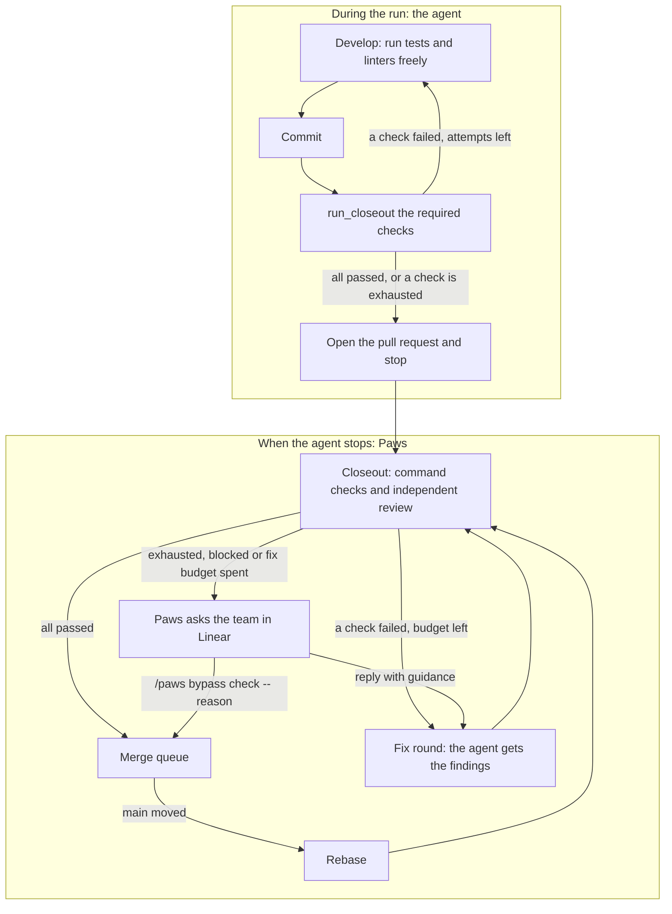

# How Closeout runs

Closeout checks a candidate before Paws opens or merges its pull request. The checks and their retry limits come from the repository's `.agents/closeout.yaml`, or from a [local Closeout policy](local-closeout.md).

The agent checks its own work during the run. When the agent stops, Paws runs Closeout on the result:

1. **The agent's checks.** While it develops, the agent runs the project's tests and linters itself. Before it finishes, it runs the required checks with `run_closeout`.
2. **Closeout.** When the agent stops, Paws runs Closeout on the candidate commit, including the independent review, and decides whether the candidate can be published.

## The agent's checks

While it develops, the agent runs the project's tests, linters and other commands in its workspace as often as it needs. These runs are not part of Closeout and have no limit.

Before it finishes, the agent runs the required checks with two tools:

- `get_closeout` returns the required checks for the changed paths, their status, and the ids still pending. It runs nothing.
- `run_closeout` runs one pending check, after any setup steps it needs, and records the result for the current commit.

These checks run in the agent's workspace. On a remote runner they run on that runner. Review checks are listed but not run here, because the review must come from a different session.

Each check has its own retry limit, `retry.maxFailedAttemptsPerItem`, which is 3 in this repository. With `scope: task`, failed attempts count across the whole task, including new commits. When a check fails, the agent fixes the cause and runs it again. When a check reaches its limit, it is exhausted. The agent stops retrying it and finishes with a short note on why, and Closeout decides what happens next.

When the agent tries to stop, the Stop hook checks the status of the required checks. While a check is still pending, the agent is sent back with the pending ids. An exhausted check does not hold the agent back.

## Closeout

When the agent stops, the item moves to `verifying` and Paws runs the policy against the candidate commit:

- **Command checks.** On a local runner, Paws runs them against the candidate checkout. On a remote runner, Paws uses the results of the agent's `run_closeout` checks for the same commit. A check passes when those results have nothing pending and nothing blocked.
- **Independent review.** A reviewer in a separate session runs the review skill. A finding at or above the policy's `failOn` severity fails the review.

The run page shows these Closeout steps and their output while they run.

### Fix rounds

When a check fails, Paws sends the findings and the failing output back to the implementing agent as a fix round. The agent fixes the cause and commits, and Paws runs Closeout again on the new commit.

A fix round that ends without a usable commit still uses one attempt. The next round gets the same findings plus the reason the last round failed. A cancelled fix stops at once.

The number of fix rounds is limited. Paws allows `maxFailedAttemptsPerItem × (checks + setup steps) − 1` rounds. Each check still stops at its own limit, so a check that keeps failing is exhausted before the overall budget runs out.

### When Paws asks the team

Paws asks in the issue's Linear session when Closeout cannot pass on its own:

- a check is exhausted,
- the fix budget is spent,
- the policy blocks the candidate, or a fix round cannot continue.

The question lists every check with its status and attempts. There are two ways to answer:

- **Reply with guidance.** The agent gets a new fix round with your guidance, and the checks get a fresh round of attempts with the same limits. Earlier evidence is kept.
- **Bypass.** `/paws bypass check-id -- reason`, or `/paws bypass check-a,check-b -- reason` for several checks, accepts those checks for this exact candidate. The bypass is recorded with the task, base, head, policy and your reason. It does not carry over to another commit.

Only a bypass in reply to this question counts. A bypass the agent proposes in its own question has no effect.

### After acceptance

An accepted candidate enters the merge queue. If `main` moves before the merge, Paws rebases the branch and runs Closeout again on the rebased commit. Closeout must accept the commit that is actually merged.
