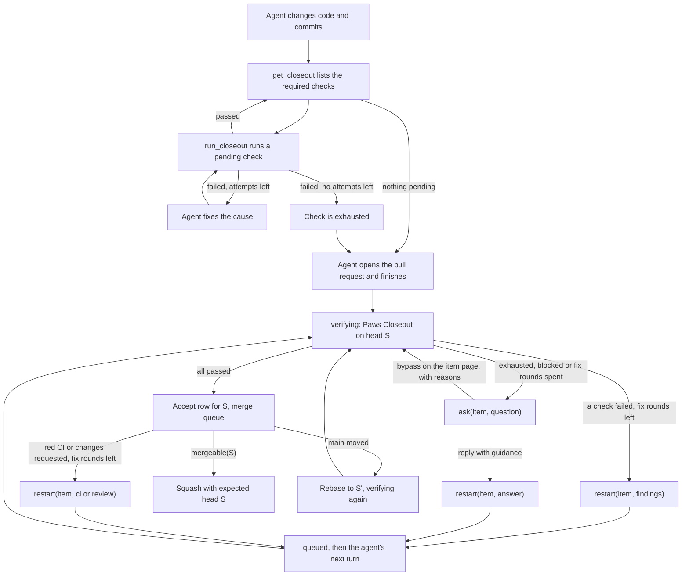

# How Closeout runs

Closeout checks a candidate before Paws opens or merges its pull request. The checks and their retry limits come from the repository's `.agents/closeout.yaml`, or from a [local Closeout policy](local-closeout.md).

Each candidate goes through Closeout twice:

1. **Agent Closeout.** The agent runs the command checks itself while it works.
2. **Paws Closeout.** After the agent's turn ends, Paws verifies the result, runs the independent review, and decides whether the candidate can be published.



## Agent Closeout

The agent uses two tools in its session:

- `get_closeout` returns the required checks for the changed paths, their status, and the ids still pending. It runs nothing.
- `run_closeout` runs one pending check, after any setup steps it needs, and records the result for the current commit.

Command checks run in the agent's workspace. On a remote runner they run on that runner. Review checks are listed but not run here, because the review must come from a different session. Evidence checks run nothing: `run_closeout` answers with the hint and the `publish_artifact` call to make.

Each check has its own retry limit, `retry.attempts_per_check`, which is 3 in this repository. With `scope: task`, failed attempts count across the whole task, including new commits. When a check fails, the agent fixes the cause and runs it again. When a check reaches its limit, it is exhausted. The agent stops retrying it and finishes with a short note on why. Paws Closeout then decides what happens next.

The agent cannot end its turn while a check is still pending. When the agent tries to finish, the Stop hook checks the Closeout status and sends the agent back with the pending check ids. A check that is exhausted does not hold the agent back.

## Evidence checks

An `evidence` check asks the agent for screenshots or videos instead of running a command. This repository requires one when a change touches the status dashboard or the landing page:

```yaml
- id: visual-proof
  kind: evidence
  gate: beforePR
  paths: ["src/web/**", "landing/**"]
  media: [image, video]
  minimum: 1
  hint: Screenshot each changed screen at desktop width and at 390 px.
```

- `paths` works as it does for the other kinds. Without a matching changed file, the check is not required.
- `media` lists which files count: `image`, `video`, or both. The default is both.
- `minimum` is how many files the check needs, from 1 to 100. The default is 1.
- `hint` is shown to the agent by `get_closeout` and in the fix round.

The agent publishes each file with `publish_artifact` and `checkId: "visual-proof"`. Paws keeps it in the evidence store, uploads it to Linear through the outbox, and embeds it in the task's session with the Paws link on the line below. Images up to 10 MB and videos up to 50 MB show inline; larger files post only the Paws link, with a note. A failed upload retries, and the last attempt posts the link instead. A file counts when it was published by this task at the candidate commit or at an earlier commit that the candidate contains, so a screenshot taken before the last commit still counts. Until enough files exist, `get_closeout` lists the check as pending and the agent cannot finish.

After the session's pull request response, evidence is attached to the issue, not posted. A thought would reopen the completed session (see [The post-PR rule](linear-agent-sessions.md#the-post-pr-rule)), so a file published by a fix round or for the re-verification of a rebased head is uploaded with `uploadOnly` and becomes a Linear attachment on the issue (`linear.attachment`), titled with its display name and bound to its head commit. The session stays quiet, and the run page and the issue show the files.

Paws Closeout counts the same files. With too few, the check fails, and a fix round asks the agent to publish the proof. That fix round does not need a new commit. Evidence checks use the same fix budget as other checks, and bypassing `visual-proof` with a reason on the item page accepts one without proof. The run page shows the published files in its evidence gallery.

### Human visual review

`approval: human` on an evidence check also requires a person to accept the files:

```yaml
- id: visual-proof
  kind: evidence
  gate: beforePR
  paths: ["src/web/**", "landing/**"]
  approval: human
```

The setting is optional. Without it, published files are enough, as above.

With it, `get_closeout` adds "Publish the screenshots, then Paws asks for a visual review in Linear." to the hint. Once enough files are published, it lists the check as `pending` and leaves it out of the pending ids, so the agent can finish its turn.

The review is a pending-human check inside the Closeout evaluation of the candidate commit. When the turn ends, the item moves to `verifying`, and Paws asks for the review in Linear with every file the check counts while the command checks and the independent review run on the same commit. It posts nothing else in the session until the review is answered, so Linear keeps showing the Accept and Request changes buttons. The files are not posted on their own. When the other checks pass first, the item waits in `awaiting_input` and gives its runner back.

- **Accept** passes the check. If the other checks are still running, the evaluation finishes when they do. If they are done, Paws completes the evaluation from their recorded results, without running them again, and the commit is accepted.
- **Request changes** restarts the item with the feedback (restart reason `review`). The agent's next turn ends in a new evaluation of its new commit. After three rounds of changes Paws asks whether to keep going.
- If another check fails, the pending review is cancelled: a fix round replaces the commit.

The review and its approval belong to the candidate commit they were asked at, and to the files the reviewer saw. When the commit changes, Paws compares the task's patch against main. A rebase that leaves the patch the same keeps an open review open and carries an accepted one to the new commit, so the reviewer is not asked again for the same diff. A different patch cancels an open review and asks again with the latest files. If files were published after an accepted review, Paws asks a new round with all of them.

A file published again for the same check, with the same display name, at the same commit replaces the earlier copy. Paws counts, asks about and lists in the pull request only the latest copy, so a review never needs to cover a superseded one. The run page shows the latest copy of each file and folds the earlier ones, from this or an older commit, under Earlier versions. The stored files stay.

Paws Closeout judges the check from an approval record: the task, the check id, the ids of the files the reviewer saw, who approved, and when. The check passes when an approval for this task and check names every file the check counts at the candidate commit. A file published after the review, for example after the reviewer asked for changes, is not covered, so the old approval no longer counts. Without a matching approval the check is `missing`: the decision is blocked, not rejected, so no fix round starts. Too few files still fail as above.

## Paws Closeout

When the turn ends, the item moves to `verifying` and Paws runs the policy against the candidate commit:

- **Command checks.** On a local runner, Paws runs them against the candidate checkout. On a remote runner, Paws uses the agent Closeout result for the same commit. A check passes when that result has nothing pending and nothing blocked. When a commit has no result, for example after a rebase, Paws runs the checks on the item's runner against that commit, the same way `run_closeout` does, and judges those results. A missing result never counts as a failed check. If the runner cannot run them, Paws retries, and then asks in Linear, saying that the checks could not run.
- **Independent review.** A reviewer in a separate session runs the review skill. A finding at or above the policy's `failOn` severity fails the review. Three optional settings on the review item make it faster:
  - `scope: diff` asks the reviewer to read only the diff and the files it changes, without searching the repository or running commands. The default, `candidate`, lets it read the whole checkout.
  - `parallel: true` starts the review alongside the command checks instead of after them.
  - `minChangedLines: N` skips the review when the change adds and removes fewer than N lines.
- **Security review.** In this repository, a candidate that changes a high-risk path also gets `security-review`: a second reviewer, in its own session and on a different model, runs `.agents/skills/security-paws/SKILL.md` on the diff. It checks the rules Paws sets for itself: secrets stay in `~/.paws/secrets` and out of logs and the agent environment, webhooks fail closed, routes and answers check authorization, SQL is not built from input, paths stay inside the worktree, and child processes are not started from input. A P1 or P0 finding fails it. Its `paths` list the high-risk globs, among them `src/auth/**`, `src/credentials/**`, the webhook handlers, route modules, and `.agents/**`. A candidate that touches none of them, such as a docs-only change, skips it.

The run page shows these steps and their output while they run. A review row shows how long the reviewer took and how many tokens it reported.

The reviewer's model and effort are set in Settings, under Agents.

### Fix rounds

A fix round is one `restart(item, reason)`: the one operation that sends an item back to the agent. Restart cancels the item's pending jobs, releases its runner slot and merge lane, records the handoff and its reason, and moves the item to `queued`. It keeps the run and the Linear session, so the round reads as part of the same story. The agent's next turn starts from the handoff and ends in `verifying` on its new commit.

Three causes are fix rounds:

| Reason     | Cause                                                          | Handoff                                                                            |
| ---------- | -------------------------------------------------------------- | ---------------------------------------------------------------------------------- |
| `findings` | Paws Closeout rejects the candidate                            | The findings and the failing output                                                |
| `ci`       | CI fails on the pull request head                              | The failing CI checks                                                              |
| `review`   | A changes-requested review or new comments on the pull request | The review or comments and their unresolved threads, once per review or comment id |

They share one counter, `retry.fix_rounds_per_item`, which defaults to 3 and only counts rounds since the latest reply from a person in the item's session. Adding checks does not raise it. The session title counts the round, for example "fixing Closeout findings (2 of 3)". Each check still stops at its own limit, `retry.attempts_per_check`, so a check that keeps failing is exhausted before the fix rounds run out.

A fix round that ends without a usable commit still counts. The next round gets the same findings plus the reason the last one failed. A cancelled fix stops at once.

For a review, the handoff tells the agent to fix what it is confident about and to ask the team in the session before changing anything unclear. A new comment restarts the item the same way: a comment-only review, a single inline comment or a conversation comment, from a person or another bot such as Cursor Bugbot. Comments that arrive while a turn or evaluation runs wait for it, and comments less than a minute apart (up to five minutes in all) become one restart. The merge waits for them. Paws ignores edits and deletions, its own App's comments, forks, ended items, and bots that only post status: the default list in `DEFAULT_IGNORED_COMMENT_BOTS` (Cloudflare Pages, Linear, Codecov, Netlify, Vercel, changesets), or `ignore_comment_bots` under `[merge.repositories."owner/repo"]` in its place. With the fix rounds spent, the next comment asks the team instead.

Two other reasons send an item back without spending a fix round: `conflict`, a rebase return from the merge lane (see [After acceptance](#after-acceptance)), and `follow_up` or `answer`, a person's message in the session. Setup faults retry once and then ask, without spending a fix round. Infrastructure faults spend nothing.

### When Paws asks the team

Paws asks through `ask(item, question)`, the one operation that asks a person. It opens one Linear elicitation in the item's session and moves the item to `awaiting_input`. It is also the only activity that reopens a session after its pull request response, because a person must see it. Paws asks when:

- a check is exhausted (`attempts_per_check` spent),
- the fix rounds are spent, whether by findings, red CI or a changes-requested review,
- the rebase returns are spent (see [After acceptance](#after-acceptance)),
- the policy blocks the candidate or cannot be read, or
- a setup fault fails again after one retry.

A spent budget is always a question, never a state of its own. `failed` means execution stopped with nothing to ask: a crash budget, a run failure or a start timeout.

The question lists every check with its status and attempts. When the candidate has failed checks and Paws has a public HTTPS link (`PAWS_PUBLIC_URL`), the question is a link ask: Linear gets one Markdown message with the link and no options, and the "Closeout needs your help" card on the item page (`/status/issues/<id>#closeout`) decides. Only the person who delegated the issue or the Linear project's lead can decide there; anyone else is refused and recorded in Audit history.

- **Bypass.** Select failed checks on the card and write a reason for each. The reasons are saved with your name, bound to the task, base, head and policy digest, and Paws verifies the same head again with them. A new commit runs every check again. The pull request body lists each bypassed check with its reason and who approved it, and Audit history records the decision.
- **Send guidance instead.** Paws calls `restart(item, answer)` with your text. The fix rounds and the check attempts start fresh with the same limits, and earlier evidence is kept. Only a person's answer for the item refills a budget; a redispatch or a newer main does not.
- **Stop.** Stops the item and keeps its branch, as the item's Stop control does.

A reply in Linear is guidance, whatever it says. `/paws bypass check -- reason` in a reply bypasses nothing: Paws sends it to the agent as guidance and answers once with the link to the card. Without a public link the question stays a Linear question, a reply is guidance, and no check can be bypassed.

### After acceptance

When Closeout accepts head S, it writes an accept row: S, the policy digest it ran under, and any bypass rows for S. The item enters `merge_queue`. The merge lane takes the repository lock, reads the pull request and checks one predicate, `mergeable(S)`:

1. The pull request head is still S.
2. S contains the current `main`.
3. An accept row exists for S under the current policy digest.
4. CI is green for S.
5. No review thread is unresolved.
6. Branch protection is satisfied.

Only when all six hold does the lane squash, with GitHub's expected-head guard set to S. A head that changes, or a main that moves between the read and the squash, releases the lane, and the next turn reads again. Paws never merges a head Closeout did not accept.

When `mergeable(S)` is false, the first failing condition decides:

- **S is behind main.** The lane rebases to a new head S', releases the lock and sends the item back to `verifying`. Closeout runs on S' like any candidate. On a remote runner, Paws runs the command checks for S' on the item's runner. A human visual approval carries over when the patch is unchanged. After the pull request, only the title ("rebased onto main, re-verifying") and the plan move.
- **No accept row for S, or the policy changed.** S goes back to `verifying`.
- **CI failed.** `restart(item, ci)` while fix rounds are left, then a question.
- **CI pending, threads open or protection unsatisfied.** The item waits in `merge_queue`.

A rebase that conflicts is a rebase return: `restart(item, conflict)` with the conflicting files, after the lane is released. Returns are limited to three in a row on a known main commit and six in any rolling hour. A conflict on an unknown main counts only toward the hour. A newer main does not refill the budget; only a person's reply does. When either limit is reached, Paws asks with the main commits and files involved.

The entry policy sets the two budget integers, both defaulting to 3:

```yaml
retry:
  attempts_per_check: 3
  fix_rounds_per_item: 3
```

`maxFailedAttemptsPerItem` remains a legacy alias for `attempts_per_check`. The legacy `[merge] ci_fix_attempts` setting in `config.toml` no longer sets a separate CI budget; CI fixes count against `fix_rounds_per_item`. `[merge] main_moved = "ci"` is rejected; see the [configuration reference](configuration.md#merge).
