# How Paws works

Paws turns delegated Linear issues into verified code changes. People describe and steer the work in Linear. Paws coordinates execution, asks questions there, verifies the resulting commit, and opens or merges the pull request on GitHub.

This implementation reference follows the source changes linked on each page. The diagrams describe the component contracts and the path a run takes through them.

[Open the architecture diagram](diagrams/system.svg) · [Download its Mermaid source](diagrams/system.mmd)

## Start here

| Question                                                 | Read                                                     |
| -------------------------------------------------------- | -------------------------------------------------------- |
| What happens after I delegate an issue?                  | [The execution loop](execution.md)                     |
| Who can sign in, administer a workspace, or pair a host? | [The control plane](control-plane.md)                  |
| How does the VM connect, fetch code, and run an agent?   | [Remote Linux hosts](remote-hosts.md)                  |
| How do we prove a change works?                          | [Verification and implementation map](verification.md) |

## Linear is the working interface

Linear holds the issue description, acceptance criteria, dependencies, human answers, and progress conversation. The implementation follows the work already specified there. A question from an agent returns to the issue, and the answer resumes that work.

The dashboard provides operational visibility and administration. Its information architecture groups work under Overview, hosts under Runners, and workspace administration under Settings. Overview opens the run, evidence, questions, and merge details when a person needs them. See the [dashboard implementation](https://github.com/pmdroid/paws-app/pull/243) and the [Runners interface contract](https://github.com/pmdroid/paws-planning/issues/52).

GitHub holds repositories, branches, pull requests, and merge checks. Linear holds the delegated work and its conversation.

## Where the pieces run

| Component                  | Responsibility                                                                                                            |
| -------------------------- | ------------------------------------------------------------------------------------------------------------------------- |
| Paws control plane         | Own the workflow, workspace authorization, durable state, runner assignments, verification coordination, and publication. |
| Linux runner daemon        | Pair the host, authenticate to Paws, receive authorized work, and report ordered events and results.                      |
| Agent process              | Work on a particular repository snapshot through the selected ACP adapter.                                                |
| Closeout                   | Evaluate the candidate and provide the verification decision used by the workflow.                                        |
| Linear and GitHub adapters | Deliver external updates and reconcile them with the recorded run.                                                        |

The control plane owns the decision to accept and publish a candidate. A runner's transport identity identifies a host. A signed command and a current run grant authorize the specific work that host may perform.

## Reading the implementation

The local workflow is documented in the repository's [smoke test](https://github.com/pmdroid/paws-app/blob/727ebfed11d9883a6143b11d38e38ea87298133f/docs/smoke-test.md). Workspace access is described by [PR 238](https://github.com/pmdroid/paws-app/pull/238). Remote host contracts are documented by the [runner protocol](https://github.com/pmdroid/paws-app/pull/207), [repository handling](https://github.com/pmdroid/paws-app/pull/227), [installer](https://github.com/pmdroid/paws-app/pull/244), [agent login bootstrap](https://github.com/pmdroid/paws-app/pull/245), [results and questions](https://github.com/pmdroid/paws-app/pull/247), and [health ledger](https://github.com/pmdroid/paws-app/pull/249).

The [implementation map](verification.md#implementation-map) connects those contracts to their owning modules. Milestone progress and acceptance decisions are recorded in the [project tracker](https://github.com/pmdroid/paws-planning/issues).
