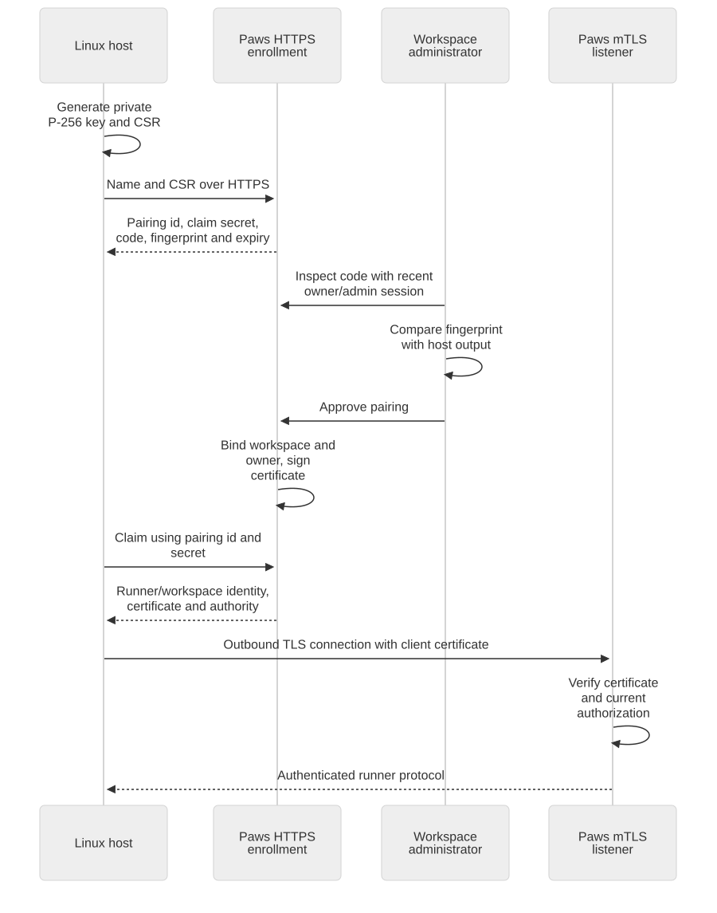

# The control plane

Paws owns workspace access and workflow state. Its browser interface and its runner protocol have separate authentication requirements.

## Workspace sign-in

The workspace access module starts Linear OAuth and validates the returned identity. It checks the installed Linear organization and the person's current membership before creating a Paws session. Workspace roles and team membership determine the operations that identity can perform.

The browser receives a `__Host-paws-session` cookie with `Secure`, `HttpOnly`, `SameSite=Lax`, and `Path=/`. SQLite stores the session token's hash. Requests authenticate the session and refresh membership through the installed Linear organization's membership reader.

State-changing browser requests require the configured origin and a matching CSRF token. Workspace selection must match the workspace authorized by the session. Administrative operations check the current role.

See [workspace access and identity links](https://github.com/pmdroid/paws-app/pull/238) and the [sign-in contract](https://github.com/pmdroid/paws-planning/issues/48).

## Pair a Linux host

[Open the pairing diagram](diagrams/pairing.svg) · [Download its Mermaid source](diagrams/pairing.mmd)

1. The host generates its private key and certificate signing request locally.
2. It sends the signing request and host name to Paws over HTTPS.
3. Paws creates a pairing request with a code, a claim secret, a request fingerprint, and a ten-minute expiry.
4. A workspace owner or administrator inspects the request and compares the fingerprint with the host's output.
5. Approval binds the runner to that workspace and owner, and the authority signs the host's certificate request.
6. The host uses its claim secret to retrieve the certificate and authority certificate over HTTPS.
7. Subsequent runner traffic uses mTLS and the registered certificate identity.

The private key stays on the host. Paws records hashes of the pairing code and claim secret. The [pairing implementation](https://github.com/pmdroid/paws-app/blob/271c77c4970aa0cde6fabf07e07666c96d57b987/src/runner-control/pairing.ts) and [public HTTPS pairing and renewal](https://github.com/pmdroid/paws-app/pull/236) define these operations.

## Authenticate every runner request

The runner checks the server's TLS identity. The runner listener requires TLS 1.3 and verifies the client's certificate against the runner authority. It serves HTTP/1.1. Application authorization checks the recorded certificate, runner status, workspace, and active owner membership.

The run service then checks the request against the current run assignment and generation. mTLS answers which host connected. The run grant answers which run that host may act on. The signed command binds the instruction itself to its destination and repository.

Renewal uses an authenticated current certificate and a new signing request. Revocation changes the recorded runner or certificate state and disconnects affected connections. The pairing and identity modules also expire connections whose certificates or owner membership are no longer accepted.

See the [runner TLS listener](https://github.com/pmdroid/paws-app/blob/04105f7362c826a08df956ad484b68314885a0d4/src/runner-identity/listener.ts), [pairing control](https://github.com/pmdroid/paws-app/blob/271c77c4970aa0cde6fabf07e07666c96d57b987/src/runner-control/pairing.ts), and [runner ingress contract](https://github.com/pmdroid/paws-planning/issues/8).

## Durable state

The control plane's SQLite database holds workflow state, jobs, outgoing updates, workspace identities, runner identities, and protocol ledgers. The connection uses WAL, `synchronous=FULL`, foreign keys, and a busy timeout. Migrations append schema changes; the workflow keeps transactions short.

Ordered event records and replayable result receipts let the receiver identify repeated delivery. Authorization and generation checks prevent a repeated message from acquiring permission for a different run.

The service ownership and network contract are tracked in [the Linux control plane issue](https://github.com/pmdroid/paws-planning/issues/25). The [database module](https://github.com/pmdroid/paws-app/tree/07d8458de8f9e1579eaee626396d4573baf1a4da/src/db) owns SQLite and migrations.
