# The execution loop

The unit of execution is a run for a delegated Linear work item. The run carries its identity, repository, selected agent profile, and generation through assignment, execution, verification, and publication.

[Open the execution diagram](diagrams/execution.svg) · [Download its Mermaid source](diagrams/execution.mmd)

## Intake and authorization

Paws reads delegated issues and their dependency relationships from Linear. It resolves the repository and checks the acting identity's access before creating work. A dependent issue becomes runnable when the workflow's dependency rules allow it.

The control plane records durable state in SQLite. Jobs represent work to perform. Outbox records represent external updates to deliver. The workflow uses the canonical transitions in `src/core`; adapters perform the external operations requested by that workflow.

See the [composition root](https://github.com/pmdroid/paws-app/blob/07d8458de8f9e1579eaee626396d4573baf1a4da/src/index.ts), [orchestrator](https://github.com/pmdroid/paws-app/blob/07d8458de8f9e1579eaee626396d4573baf1a4da/src/loop/orchestrator.ts), and [Linear task access](https://github.com/pmdroid/paws-app/blob/07d8458de8f9e1579eaee626396d4573baf1a4da/src/loop/linear-task-access.ts).

## Assign a specific run

A signed runner command binds the runner and workspace to a run, work item, generation, repository URL, base commit, and agent profile. It also carries an issue time and expiry. The receiver validates the signature and the command's bindings before accepting the work.

The work service creates a current assignment and lease. Heartbeats authenticate the runner, renew valid assignment leases, and report fenced assignments. Events, results, and answer polling additionally require the current run's grant. Generation fencing lets the control plane reject traffic belonging to an older assignment.

See the [command schema and signature verification](https://github.com/pmdroid/paws-app/pull/207) and [work service](https://github.com/pmdroid/paws-app/pull/235).

## Execute and ask questions

The repository helper prepares the exact assigned base commit. The worker starts the selected agent through ACP and reports progress. Agent authentication belongs to that agent's host account.

When the agent needs a human decision, `ask_team` records a question and Paws delivers it to Linear. The human answers in the issue conversation. The runner obtains the answer through its authorized run channel, and the workflow resumes the work.

The work service persists ordered events. The results service persists results and question answers. Delivery orders answers by question order and holds later answers behind an earlier unanswered question. Replaying an identical accepted result is acknowledged as a duplicate. A changed payload for the same receipt is rejected. See [PR 247](https://github.com/pmdroid/paws-app/pull/247).

## Verify the candidate

A candidate has an exact commit identity. Closeout evaluates that candidate using the configured verification contract. A rejected candidate returns to the repair loop with the findings. An accepted candidate can proceed to publication under the workflow's guards.

Trusted check inputs and the evaluator are separate responsibilities. The trusted-input implementation binds the check inputs used by the verifier. See [PR 239](https://github.com/pmdroid/paws-app/pull/239), the [Closeout module](https://github.com/pmdroid/paws-app/tree/07d8458de8f9e1579eaee626396d4573baf1a4da/src/closeout), and the [verification contract](https://github.com/pmdroid/paws-planning/issues/17).

## Publish and unblock

The publication path checks the candidate's identity and repository binding before pushing the Paws branch. The control plane opens the GitHub pull request and applies its verification and merge guards. A serial merge path prevents concurrent merge attempts from racing the target branch.

Paws reports the outcome to Linear. Merging an item can unblock the next dependent item. The [smoke test](https://github.com/pmdroid/paws-app/blob/727ebfed11d9883a6143b11d38e38ea87298133f/docs/smoke-test.md) exercises a three-issue dependency chain, one question, a failed verification followed by repair, and pull request merges.
